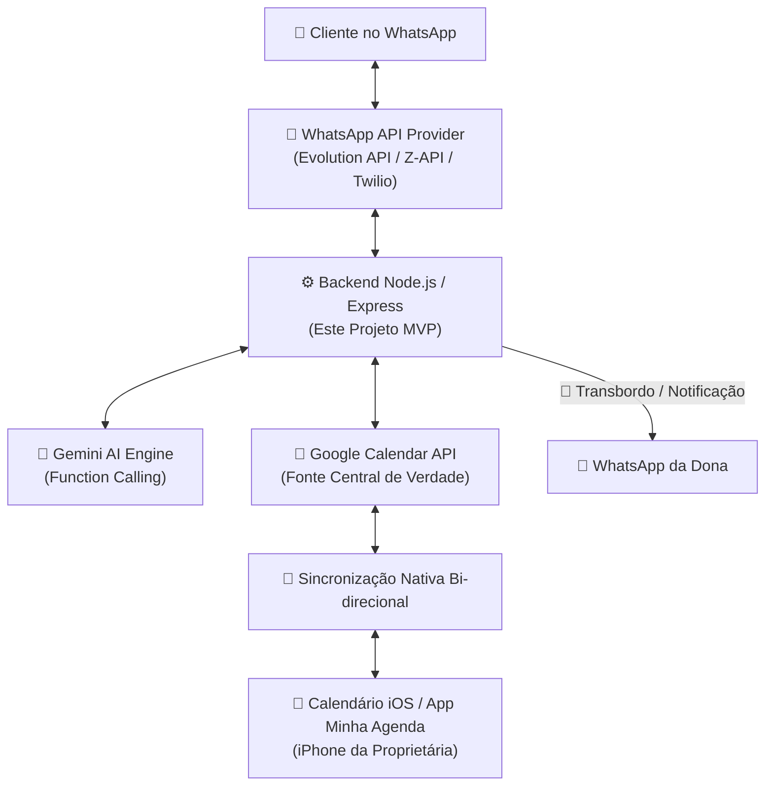

# 💇‍♀️ Agente de IA para Atendimento e Agendamento via WhatsApp - Studio JF Designer

MVP completo de um assistente virtual inteligente integrado ao WhatsApp para automação de atendimento em salões de beleza, com consulta de agenda em tempo real no **Google Calendar** (sincronizável com o aplicativo **"Minha Agenda"** no iOS), gerenciamento de duração de serviços e transbordo humano automatizado.

---

## 📐 Estrutura do Projeto

```
salon-whatsapp-agent/
├── package.json
├── tsconfig.json
├── .env.example
├── README.md
└── src/
    ├── index.ts                   # Servidor Express & Rotas de Webhook
    ├── config/
    │   └── salonConfig.ts         # Tabela de preços, combos, durações e expediente
    ├── prompts/
    │   └── systemPrompt.ts        # System Prompt oficial e regras da IA (Alícia)
    └── services/
        ├── calendarService.ts     # Integração com Google Calendar API (Cálculo de slots livres)
        ├── aiService.ts           # Motor Gemini AI com Function Calling (Tools)
        └── whatsappService.ts     # Envio de mensagens e notificações via WhatsApp Provider
```

---

## 🔄 Estratégia de Integração com o App "Minha Agenda" (iOS)

O aplicativo **"Minha Agenda"** para iPhone permite sincronizar agendamentos com os calendários nativos do iOS ou com o **Google Calendar**.



### Passo a Passo da Sincronização:
1. **Google Calendar como Hub Central:** O robô lê disponibilidades e cria compromissos diretamente no Google Calendar via Service Account.
2. **Sincronização no iPhone da Dona:** No aplicativo "Minha Agenda" ou nas Configurações de Conta do iOS (Ajustes > Calendário > Contas), a proprietária adiciona a conta do Google usada pelo salão.
3. **Sincronização em Tempo Real:** Qualquer bloqueio, agendamento manual ou alteração feito pela dona no app "Minha Agenda" é refletido instantaneamente no Google Calendar, impedindo que o robô faça sobreposição de horários (overbooking).

---

## ⚡ Como Executar o Projetos

### 1. Instalar Dependências
```bash
npm install
```

### 2. Configurar Variáveis de Ambiente
Copie o arquivo `.env.example` para `.env` e preencha suas chaves:
```bash
cp .env.example .env
```

### 3. Rodar em Modo de Desenvolvimento
```bash
npm run dev
```

### 4. Testar o Atendimento (Sem precisar de instância do WhatsApp ativa)
Você pode enviar uma requisição `POST` para `http://localhost:3000/test-chat`:
```json
{
  "phone": "5511999998888",
  "message": "Quais são os combos promocionais e quanto custam?"
}
```

---

## 🛡️ Principais Regras de Negócio Implementadas

1. **Cálculo de Janela de Tempo:** Cada serviço ou combo possui uma duração estimada fixa (ex: Manicure 45 min, Combo Pé e Mão 80 min, Spa Day 180 min). A busca de horários calcula a janela necessária contínua sem colidir com compromissos existentes.
2. **Transbordo Humano:** Quando a cliente solicita alterações complexas, reclamações ou pede atendente humana, a IA ativa a ferramenta `handover_to_human`, pausa a automação para aquela cliente e envia uma notificação no WhatsApp da proprietária com o link direto da conversa.
3. **Formatação de WhatsApp:** Respostas curtas, amigáveis, com uso estratégico de negrito e emojis para proporcionar excelente experiência ao cliente.
